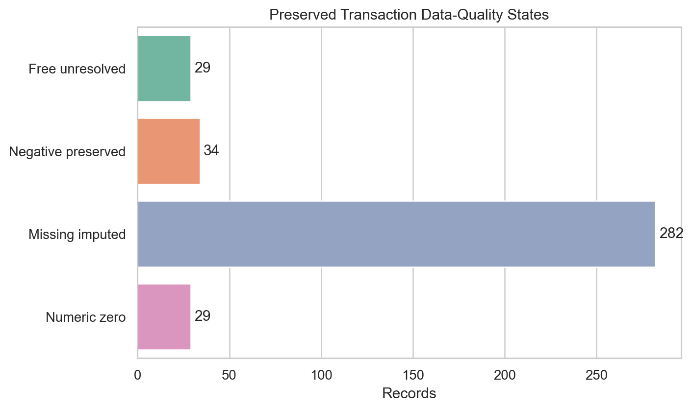
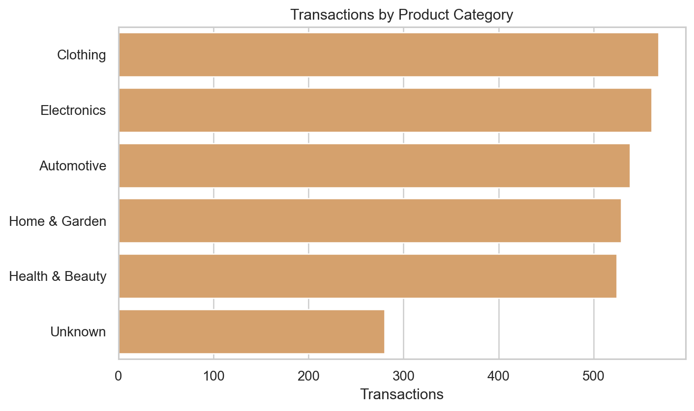
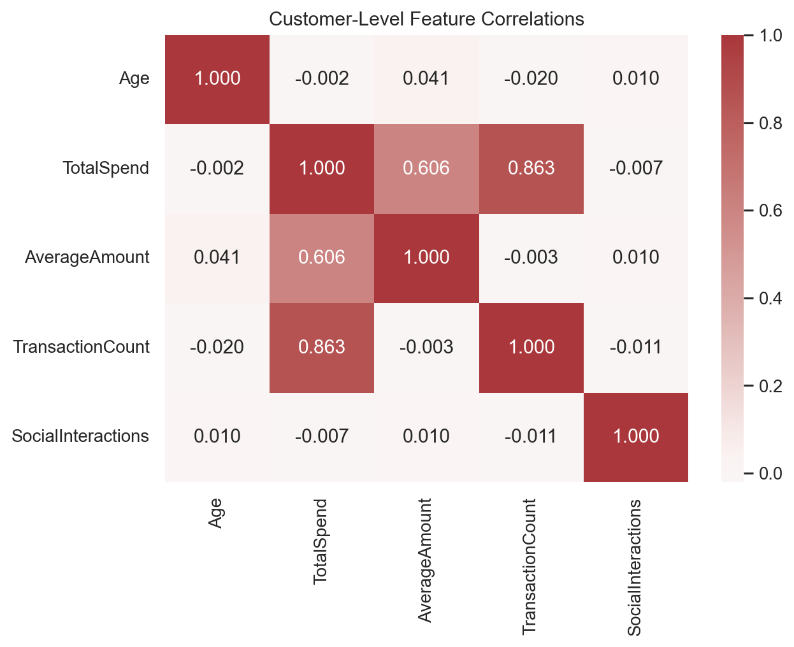

# MO-IT162 Terminal Assessment - ML Solution

## BSIT-H3101 - Group 6

**Team members:** Danica Mae Tugare, Christian Cristobal, and Pg Amir Nur Mohammad Urbano

FinMark customer data preprocessing, exploratory analysis, and model-readiness review

---

# Business Goal and Data Architecture

- Prepare reliable customer, transaction, and social features for segmentation and future predictive modeling.
- Demographics describes customer attributes; transactions records signed financial events; social data records platform engagement and sentiment.
- `CustomerID` connects datasets. `TransactionID` and `InteractionID` identify events.
- IDs support joins and validation; they are not direct predictive features.

---

# Source and Reproducibility

- Course-provided FinMark MFML CSVs are preserved unchanged under `data/raw/`.
- Official project website: [FinMark Corporation](https://sites.google.com/mmdc.mcl.edu.ph/finmarkcorp/home).
- Cleaning code and outputs are in `terminal_ml_solution_project.ipynb`.
- Final calculations and charts are in `Final_ml_visualizations.ipynb` and `finmark_analysis.py`.
- Machine-readable evidence is exported under `evidence/`.

---

# Cleaning Verification

| Dataset | Raw -> Clean | Exact duplicates | Conflicting IDs | Duplicate IDs after |
|---|---:|---:|---:|---:|
| Demographics | 3,200 -> 3,000 | 177 | 23 | 0 |
| Transactions | 3,200 -> 3,000 | 185 | 15 | 0 |
| Social | 3,200 -> 3,000 | 180 | 20 | 0 |

All conflicts were verified as one original row plus one modified appended contamination row before retaining the original.

---

# Preserving Transaction Meaning

- 29 `Free` labels remain unresolved numerically and flagged.
- 34 negative amounts remain signed and flagged for refund/reversal review.
- 282 genuinely missing source amounts are median-imputed and flagged.
- 29 genuine numeric zeros remain distinguishable from `Free`.
- Review flags preserve traceability for modeling and business validation.

---

# Descriptive Evidence

- Age: mean 44.680; median/mode 45; standard deviation 14.437; range 18-70.
- Amount: 2,971 numeric records; mean 491.931; median/mode 497.49.
- Signed amount range: -100.00 to 999.86; standard deviation 283.658.
- The central spikes partly reflect median imputation and must not be interpreted as purely natural modes.

---

# Category Evidence

- Income levels: High 935, Low 918, Medium 863, Unknown 284.
- Product categories are relatively balanced; the largest is Clothing at 568 records.
- Sentiment: Positive 898, Neutral 870, Negative 861, Unknown 308.
- Rare extreme sentiment classes remain separate rather than being silently merged.

---

# Customer-Level Relationships

- `TotalSpend` and `TransactionCount`: **r = 0.863**.
- `TotalSpend` and `AverageAmount`: **r = 0.606**.
- Age and social-interaction volume have near-zero linear correlations with spending measures.
- Spending features are mathematically related; using all of them may introduce multicollinearity.
- Correlation is descriptive and does not establish causation.

---

# Outliers and Time Trends

- 1.5 x IQR screening: 0 age outliers and 0 amount outliers.
- Negative amounts can still be business-significant even when not IQR outliers.
- Peak transaction volume: May 2024, 149 transactions.
- Highest monthly average signed amount: August 2023, 548.843.
- Peak social activity: July 2023, 270 interactions.
- The observed period is too short to claim seasonality.

---

# Modeling Recommendations

- Retain missingness and amount-review flags.
- Encode categories while preserving `Unknown` as a separate state.
- Scale numeric features for distance-based models.
- Split customer-level models by `CustomerID`; use chronological validation for forecasting.
- Evaluate nonlinear effects and interactions despite near-zero simple correlations.
- Confirm `Free` and negative transaction meanings with FinMark before production modeling.

---

# Feedback Resolved

- Added explicit record counts and source status.
- Added before/after cleaning and conflict evidence.
- Added descriptive statistics, category counts, correlations, and outlier counts.
- Added quantitative support to interpretations.
- Removed unsupported assumptions about duplicate retention and transaction semantics.
- Organized authoritative notebooks, code, datasets, figures, evidence, and presentation resources.

---

# Conclusion

- Three finalized 3,000-record datasets have unique business IDs and traceable preprocessing.
- Analytical definitions are consistent across notebooks, evidence files, figures, and slides.
- The package is reproducible and ready for final team review and repository submission.